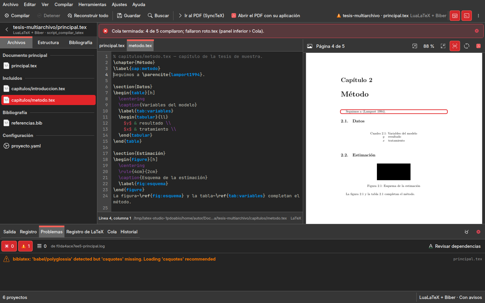

# latex-studio/ — LaTeX Studio, el entorno de escritura científica, y el compilador del .tex suelto (repo `scripts_for_latex`)

<!-- suites:inicio -->
Suites de esta carpeta (2); índice global en `meta/INDICE_SCRIPTS.md`. Patrón: M main · C config · L lib.

| Suite | Carpeta | Objetivo | Escribe en | Simula | Timer | Estado | Patrón |
|---|---|---|---|---|---|---|---|
| `compilar_latex` | [latex-studio/script_compilar_latex](script_compilar_latex/) | latex | archivos | no |  | activo | `MCL` |
| `latex_studio` | [latex-studio/studio](studio/) | latex | archivos | no |  | activo | `M··` |

<sub>Bloque generado desde los `suite.yml` por `core/suites.py generar` (2026-10-31); no se edita a mano.</sub>
<!-- suites:fin -->

## Qué es

**LaTeX Studio** (`studio/`): el entorno donde el autor escribe, compila y revisa sus proyectos LaTeX. Detecta los
proyectos de las carpetas de trabajo (por omisión `escritura` y el despacho, por `core/env.py`, más las que se añadan;
un proyecto es su documento principal con sus `\input`, sus `.bib` y su configuración), los agrupa por categoría solo
cuando hay información, y los compila **cada uno con su compilador y su motor**: el build de su marco (`escritura`),
latexmk si tiene `latexmkrc`, o la CLI de este repo con el motor que declare (LuaLaTeX + Biber si no declara nada). El
editor integrado resalta LaTeX y BibTeX, muestra la estructura, completa `\ref` y `\cite`, busca y reemplaza; el PDF
se ve en la misma ventana con SyncTeX en los dos sentidos; los errores llegan con causa probable y acción recomendada.
Diseño y decisiones: `docs/reingenieria.md`.

**`script_compilar_latex/`** (alias `compilar`): compila un `.tex` suelto desde cualquier carpeta: resuelve la ruta,
elige el motor (`auto` = LuaLaTeX salvo `% !TEX program`), encadena pasadas fijas con Biber o BibTeX, makeindex y
makeglossaries, informa del PDF y borra los auxiliares (salvo con `-k`). Es para el `.tex` que no pertenece a un
framework: `escritura`, `11 Book`, el marco documental y los `academic-*` de `docencia` compilan con su propio build. No
trae clases ni plantillas (eso es `sistema-editorial`). Quién la llama por código y qué no se puede cambiar sin avisar:
`docs/arquitectura.md` §Consumidores.



## Uso

```bash
/usr/bin/python3 studio/main.py [documento.tex]                     # LaTeX Studio: la ventana (F5 compila, Ctrl+K paleta; el Python del sistema)
script_compilar_latex/main.sh --help                                # opciones (no compila)
script_compilar_latex/main.sh -e lualatex --biber documento         # el modo normativo: LuaLaTeX + Biber
script_compilar_latex/main.sh --dry-run -e lualatex --biber documento   # simula: dice qué haría, no escribe
script_compilar_latex/main.sh -c documento                          # solo borra los auxiliares
script_compilar_latex/main.sh -k -e lualatex --biber documento      # conserva los auxiliares (SyncTeX)
compilar -e lualatex --biber ~/Documents/escritura/<carpeta>/nota   # alias de ~/.dotfiles (zsh)
script_compilar_latex/tests/dry-run.sh                              # prueba de suite: --dry-run no escribe
```

En la ventana (QML + Kirigami sobre `gui-comun` 2.x; `studio/README.md` tiene las vistas y los atajos): Ctrl+1
Proyectos, Ctrl+2 Escritura; F5 o Ctrl+B compila, F6 reconstruye, F8 va al siguiente problema, Ctrl+clic en el editor
lleva al PDF y doble clic en el PDF vuelve al código. Corre con `/usr/bin/python3` (el Qt del sistema, que trae Kirigami).

El manual (opciones, cómo se indica la ruta, qué borra la limpieza, problemas frecuentes) es
`script_compilar_latex/README.md`; el porqué de cada elección, `docs/decisiones.md`; lo pendiente,
`estado.md`.

## Estructura

| carpeta | qué es | dueño / generador |
|---|---|---|
| `script_compilar_latex/` | la suite: `main.sh`, `config.sh`, `lib/`, `tests/`, su manual y `suite.yml` | a mano; el bloque `suite:` del manual lo genera `core/suites.py` |
| `studio/` | LaTeX Studio: `main.py`, `latex_app/` (servicios sin Qt: `proyectos.py`, `estructura.py`, `diagnostico.py`, `visor.py`, `compilador.py`, `escritorio.py`; `controladores/`; `qml/`), `studio/ejemplo/proyectos/` (la muestra de las pruebas y las capturas), `capturar.py` y su `suite.yml` (`studio/README.md`) | a mano |
| `tests/` | `tests/run.sh`: la detección, la estructura, los diagnósticos, el visor y SyncTeX, los controladores y la ventana (sin pantalla, con `/usr/bin/python3`), compilando la muestra en una carpeta temporal | a mano |
| `docs/` | `reingenieria.md` (el entorno de escritura: diagnóstico, referencias, R1–R16), `arquitectura.md` (la CLI: flujo, módulos, consumidores), `decisiones.md`, `rediseno.md` (la ventana 2.0, superada) y `figuras/` (`antes/`: la 2.0) | a mano |

## Límite honesto

- **La CLI no usa latexmk**: pasadas fijas (`-p`, 2 por defecto y 3 con bibliografía o glosario). La ventana usa
  latexmk solo para el proyecto que tiene `latexmkrc`.
- **El visor PDF no usa QtPdf** (no instalado): las páginas son imágenes; SyncTeX necesita el `.synctex.gz` del
  compilador del proyecto (el de `escritura` todavía no lo genera).
- **El modo watch vigila solo la carpeta del `.tex`**, sin subcarpetas, y necesita `inotifywait`
  (Linux) o `fswatch` (macOS).
- **La tilde entre comillas no se expande**: `"$HOME/Documents/…"` o la tilde fuera de las comillas.
- **`--draft` no produce PDF**: con lualatex el PDF anterior se pierde.
