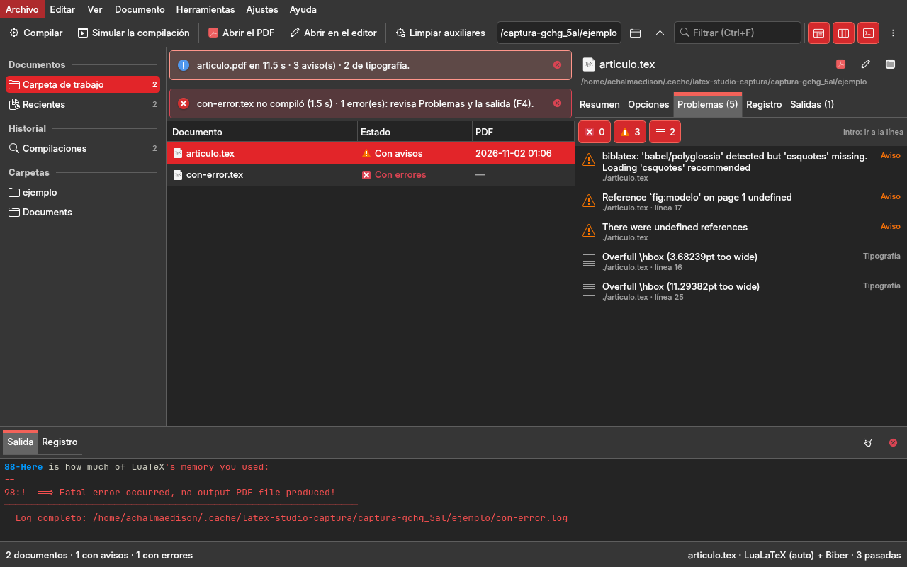
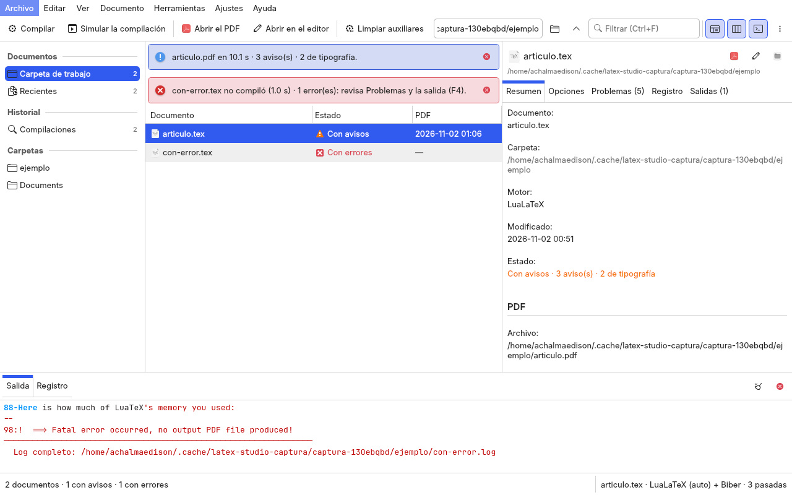
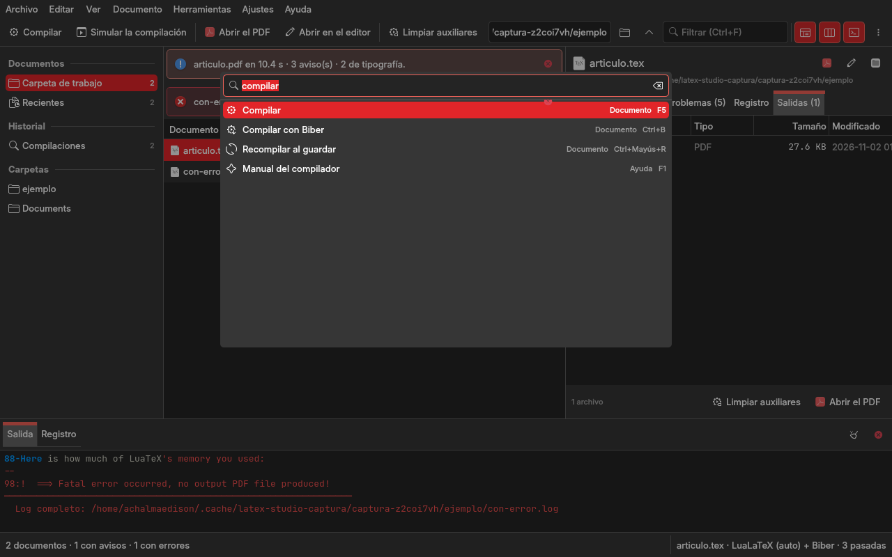

# Rediseño de LaTeX Studio: los documentos `.tex` de una carpeta, su estado y su compilación en una ventana de trabajo

Fase 5 de la modernización de la familia de studios (`gui-comun/docs/arquitectura-qml-kirigami.md` §8): LaTeX
Studio es el cuarto que sigue al piloto Git Studio, cuyo lenguaje visual y arquitectura de información
(`git-studio/docs/rediseno.md` §2, §4, §6, §8) el autor aprobó el 2026-11-01 «para todos los programas de la
familia». Filesystem Studio, Dotfiles Studio y Huella Studio mostraron cómo se aplica a un studio de herramientas:
una ventana, una operación que corre en el panel inferior con progreso y cancelación, lo que borra se muestra antes
y se confirma. Este documento aplica ese diseño a este studio: la auditoría de lo que hay (§1), las ocho preguntas
de producto (§2), la arquitectura de información (§3), la ventana (§4), lo construido (§5), los componentes (§6), lo
que el marco necesitó (§7) y las decisiones (§8). **Está construido** (rama `wip/2026-11-02-qml`, 2026-11-02): las capturas de §5 son reales; pasa a `hecho` cuando el
autor valide el studio en la sesión real (P3, `../estado.md`).

Dos reglas que condicionan todo lo demás: **el motor es LuaLaTeX + Biber** (regla 6 del workspace; `decisiones.md`
§2.1): la ventana no ofrece pdfLaTeX ni XeLaTeX; y **la ventana no compila por su cuenta** (`../CLAUDE.md`): arma la
orden de `script_compilar_latex/main.sh` (la misma de `docencia` y del alias `compilar`) y lee lo que esta deja.

## 1. Auditoría de la GUI actual (Widgets, `gui-comun` 1.x)

Tres páginas en una barra lateral con la marca «LaTeX Studio · Compilar documentos» (el módulo `ventana.py` de 1.x,
retirado en esta fase; `git show main:studio/latex_app/ventana.py`), construidas a mano con `gui_comun.widgets`: tarjetas, cifras, mosaicos, listas con
vacío, consola como cajón (Ctrl+J), paleta Ctrl+K, avisos. La lógica está separada en un módulo sin Qt,
`studio/latex_app/compilador.py` (`Opciones.orden()` arma la orden de la CLI; `leer_log()` saca errores, avisos y
avisos tipográficos del registro con su archivo y su línea; `resumen()` los cuenta), que se conserva intacto: esta
fase solo le añade consultas.

| página | qué hace hoy | entidades y operaciones | lógica separada | mezclado en la ventana |
|---|---|---|---|---|
| Inicio | tres cifras (recientes, última compilación, motor por omisión), tres mosaicos (abrir, compilar, historial) y la lista de recientes (doble clic abre) | documento (recientes) | — | el recuento y el texto de cada cifra; la lista se pinta a mano; es un panel de control |
| Compilar | el campo de la ruta con Abrir…, Simular y Compilar; la tarjeta Opciones (motor con pdfLaTeX y XeLaTeX «heredados», pasadas, bibliografía, índice, glosarios, borrador, carpeta del PDF, abrir al terminar, recompilar al guardar); la tarjeta Resultado (estado en una línea, la lista de problemas con doble clic que abre Kate en la línea, Abrir el PDF, Carpeta, Limpiar auxiliares con `QMessageBox`) | documento, opciones, corrida (`main.sh`), problema, PDF, auxiliares | `Opciones`, `leer_log`, `resumen` | la lectura del `.log`, el recuento, el estado como texto, la ruta de la caché, el editor (`kate --line`), el `QFileSystemWatcher` de «recompilar al guardar», el temporizador, la confirmación de limpiar sin mostrar qué borra |
| Historial | la lista de compilaciones (documento, resultado, segundos, fecha, detalle, carpeta; doble clic vuelve a ese `.tex`) y «Vaciar el historial» | compilación | — | la persistencia en `QSettings` (JSON), el pintado a mano |

Lo que falta hoy: ningún lugar dice **qué documentos hay** en una carpeta ni **en qué estado** está cada uno (si su
PDF está al día, si la última compilación falló); la ventana solo conoce el `.tex` que se le escribió. El registro
íntegro de la corrida no se lee desde la ventana (se pierde con el temporal de la CLI); «Limpiar auxiliares» pregunta
sin decir qué va a borrar (regla 3 del workspace); el PDF resultante no tiene ni fecha ni tamaño a la vista; la
compilación no informa de su progreso (la CLI anuncia cada pasada y la ventana lo ignora). Preferencias: solo
`ui/tema`, que en 2.x no hace nada (el tema es del escritorio). El lanzador instalado apunta al Python de Anaconda,
que no carga Kirigami.

## 2. Las ocho preguntas de producto

1. **Tarea principal**: compilar un `.tex` suelto (el que no pertenece a un framework) con LuaLaTeX y Biber, ver si
   compiló, leer cada error y aviso con su línea y corregirlo en el editor, volver a compilar; de paso, saber en qué
   estado están los documentos de la carpeta en la que se trabaja. El documento es el sujeto; compilar, simular y
   limpiar, los verbos; las opciones, los adverbios.
2. **Información constante**: qué documento es el actual y con qué opciones se compila (motor, bibliografía, pasadas);
   cuántos documentos hay en la carpeta y cuántos están compilados, con avisos, con errores o sin compilar; si hay una
   compilación en curso y en qué pasada va. → la **barra de estado** (recuento a la izquierda, documento y opciones a
   la derecha, el progreso en medio) y la **columna Estado** de la tabla.
3. **Acciones más frecuentes**: compilar (F5), compilar con Biber (Ctrl+B), simular (Mayús+F5), abrir el PDF, abrir
   el `.tex` en el editor (en la línea de un problema), limpiar auxiliares. → **la barra**: Compilar · Simular ·
   Abrir el PDF · Abrir en el editor · Limpiar auxiliares…; y el campo de la carpeta de trabajo con el filtro.
4. **Lo que permanece visible**: la tabla de documentos y la barra de estado. Navegación, detalles y salida se pliegan.
5. **Operaciones contextuales** (sobre un documento): compilar, simular, limpiar, abrir el PDF, abrir en el editor,
   abrir la carpeta en Dolphin, abrir terminal ahí, copiar la ruta; sobre un problema: ir a la línea; sobre una
   compilación del historial: volver a ese documento, quitarla. → **menú contextual y panel de detalles.**
6. **Solo cuando se pide**: las opciones de compilación; cada error y aviso con su archivo y su línea; el registro
   íntegro de la corrida; el PDF (fecha, tamaño, páginas) y los auxiliares que hay en la carpeta; el historial de
   compilaciones. → **panel de detalles** (Resumen · Opciones · Problemas · Registro · Salidas), **vista Historial**,
   **panel inferior** (la salida en vivo).
7. **Una sesión completa**: abrir → la carpeta de trabajo de la última vez ya está y la tabla dice qué documentos hay
   y en qué estado (se lee del disco al arrancar) → se elige el `.tex` (o se abre otro con Ctrl+O, o se suelta en la
   ventana: su carpeta pasa a ser la de trabajo) → Opciones dice LuaLaTeX, Biber, 3 pasadas → F5: la salida de
   `main.sh` corre en el panel inferior, la barra de estado dice «pasada 2 de 3», Esc cancela → al terminar, la fila
   cambia a «con avisos», Problemas lista «Reference `fig:x' undefined · línea 42» → Intro abre Kate en esa línea → se
   corrige y se guarda: con «Recompilar al guardar» la compilación vuelve a correr sola → «Abrir el PDF» → F4 cierra
   la salida.
8. **Tamaños**: como el piloto (§4.2 de su rediseño): bajo 900 px la navegación se pliega a iconos y los detalles se
   abren como hoja; las columnas Modificado y Motor de la tabla se ocultan al estrecharse.

## 3. Arquitectura de información

### 3.1 Tres vistas, un documento actual, una ventana

Las tres páginas desaparecen como páginas. Hay **tres vistas** del centro, que se eligen en el panel de navegación
(Ctrl+1 · Ctrl+2 · Ctrl+3), y en todas ellas la fila seleccionada fija el **documento actual**, sobre el que actúan
Compilar, Simular, Limpiar, Abrir el PDF y Abrir en el editor y del que hablan los detalles.

| vista | centro | detalles (pestañas) | panel inferior | F5 |
|---|---|---|---|---|
| Carpeta de trabajo | `TablaDatos`: los `.tex` de la carpeta (Documento, Estado con color semántico, Motor declarado, PDF, Modificado), ordenable y filtrable | Resumen (documento, carpeta, motor, modificado, estado, PDF con fecha, tamaño y páginas, última compilación) · Opciones (motor, pasadas, bibliografía, índice, glosarios, borrador, carpeta del PDF, abrir al terminar, recompilar al guardar; Simular y Compilar al pie) · Problemas (n) (cada error, aviso y aviso tipográfico con su archivo y su línea; Intro abre el editor ahí; filtros por nivel) · Registro (la salida íntegra de la última corrida de ese documento) · Salidas (el PDF y los auxiliares que hay en la carpeta, con tamaño y fecha; Abrir el PDF y Limpiar auxiliares…) | la salida de `main.sh` línea a línea (Salida) y los eventos de la sesión (Registro) | compila el documento actual |
| Recientes | la misma tabla sobre los últimos documentos abiertos o compilados (con su carpeta) | los mismos | | compila el documento actual |
| Historial | `TablaDatos`: cada compilación (Cuándo, Documento, Resultado con color, Duración, Detalle, Carpeta); elegir una fila vuelve a ese documento | los mismos (del documento de la fila) | | compila el documento actual |

**Inicio** se reparte: las cifras van a la **barra de estado** y a los **contadores de la navegación**; los
mosaicos son acciones del menú; la lista de recientes es la vista **Recientes**. **Compilar** deja de ser un lugar: las
opciones viven en la pestaña **Opciones** de los detalles, el resultado en **Problemas**, **Registro** y **Salidas**,
y compilar es una acción (F5) desde cualquier vista. **Historial** es una vista con tabla. La ventana gana lo que no
tenía: la **tabla de la carpeta** con el estado de cada documento, el **registro íntegro** de cada corrida, el
**progreso por pasadas** y la **lista de lo que Limpiar va a borrar** antes de borrarlo. La paleta ofrece, además de
las órdenes, cada documento de la carpeta («Documento: …» lo selecciona) y cada carpeta reciente («Carpeta: …»).

### 3.2 Entidades y dónde vive cada dato

| entidad | datos | dónde |
|---|---|---|
| Documento `.tex` (`compilador.documentos_en(carpeta)`) | ruta, nombre, carpeta, modificado, motor declarado (`% !TEX program` en las 5 primeras líneas; sin él, LuaLaTeX: la misma regla que `script_compilar_latex/lib/detector.sh`), estado, PDF (ruta, fecha, tamaño, páginas si hay `pdfinfo`) | fila de la tabla; Resumen; título del panel de detalles; contexto de la barra de estado |
| Estado de un documento (`compilador.estado_de(tex, registro)`, leído del disco, §8 L5) | `compilado` (PDF más nuevo que el `.tex`, sin problemas), `con avisos`, `con errores` (el registro de la última corrida o el `.log` del motor que dejó un fallo), `desactualizado` (PDF más viejo que el `.tex`), `sin compilar` (sin PDF), `compilando` | columna Estado (positivo · neutro · negativo · activo · inactivo); Resumen; recuento de la barra de estado |
| Opciones de compilación (`QSettings`, de la sesión, §8 L6) | motor (`auto` · `lualatex`), pasadas (1–5; 3 con bibliografía o glosario), bibliografía (ninguna · Biber · BibTeX heredado), índice, glosarios, borrador, carpeta del PDF, abrir el PDF al terminar, recompilar al guardar | pestaña Opciones; contexto de la barra de estado («LuaLaTeX + Biber · 3 pasadas»); menú Documento (las dos marcables) |
| Corrida (`main.sh … --log <registro>`; `Opciones.orden()`) | la orden, su salida línea a línea, la pasada en curso («Pasada n/N»), el código de salida, la duración | panel inferior (Salida); barra de estado (progreso por pasadas, Esc cancela); al terminar, la fila y los detalles se releen y la compilación entra al historial |
| Registro de la corrida (`--log`, un archivo por documento en la caché del studio, §8 L4) | la salida íntegra del motor, Biber, makeindex y makeglossaries | pestaña Registro (`VistaTexto`, monoespaciado); de él salen Problemas y el estado |
| Problema (`compilador.leer_log`) | nivel (error · aviso · tipografía), mensaje, archivo, línea | pestaña Problemas (`ListaDiagnosticos`, color por nivel; Intro abre el editor en la línea); contador en la pestaña; Detalle del historial |
| PDF y auxiliares (`compilador.salidas_de(tex)`: el PDF y los `<nombre>.<ext>` de `EXTENSIONES_AUXILIARES` de `config.sh`, más los `.aux` que el `.aux` declara con `\@input`: la misma lista que `listar_auxiliares` de la CLI) | nombre, tipo (PDF · auxiliar), tamaño, fecha | pestaña Salidas (tabla); el diálogo de Limpiar auxiliares… (la lista de lo que se borraría, antes de borrar) |
| Compilación del historial (`QSettings`, hasta 60, las claves de 1.x se conservan) | documento, resultado, segundos, detalle, cuándo, errores, avisos | vista Historial (Resultado con color); «última compilación» en Resumen |
| Carpeta de trabajo y carpetas recientes (`QSettings`) | la carpeta cuyos `.tex` llena la tabla; las últimas ocho | campo de la barra de herramientas; sección Carpetas de la navegación; título de la ventana («carpeta — LaTeX Studio») |
| Preferencias (`QSettings`) | editor (`kate`; con `--line`), terminal (`konsole`) | «Configurar LaTeX Studio…» |

### 3.3 Dónde vive cada operación

Toda operación existe una sola vez, en `Acciones` (`studio/latex_app/aplicacion.py`), y aparece en los lugares de la
tabla.

| operación | menú | barra | contextual | detalles | paleta | atajo |
|---|---|---|---|---|---|---|
| Abrir un .tex… (su carpeta pasa a ser la de trabajo y queda seleccionado) · Carpeta de trabajo… · Carpeta superior | Archivo | ● (campo de la carpeta) | | | ● | Ctrl+O · Ctrl+Mayús+O · Alt+↑ |
| Abrir en Dolphin · Abrir terminal aquí · Copiar ruta (del documento actual; si no, la carpeta) | Archivo | | ● | ● (Resumen) | ● | Mayús+F4 · Ctrl+Mayús+C |
| Filtrar · Seleccionar todo | Editar | ● (campo) | | | ● | Ctrl+F · Ctrl+A |
| Quitar del historial · Vaciar el historial | Editar | | ● (Historial) | | ● | Supr |
| Ir a cada vista (Carpeta de trabajo · Recientes · Historial) | Ver › Vista | | | | ● | Ctrl+1 · Ctrl+2 · Ctrl+3 |
| Releer la carpeta | Ver | | ● | | ● | Ctrl+R |
| Paneles · pantalla completa | Ver | ● | | | ● | F9 · F11 · F4 · Ctrl+Mayús+F |
| Compilar · Compilar con Biber · Simular la compilación (`-n`) | Documento | ● (Compilar, Simular) | ● | ● (Opciones, Resumen) | ● | F5 · Ctrl+B · Mayús+F5 |
| Cancelar la compilación | Documento | (barra de estado) | | | ● | Esc |
| Limpiar auxiliares… (muestra la lista y confirma) | Documento | ● | ● | ● (Salidas) | ● | Ctrl+Mayús+L |
| Abrir el PDF · Abrir en el editor | Documento | ● | ● | ● (Resumen, Salidas) | ● | Ctrl+Mayús+P · Ctrl+E |
| Recompilar al guardar · Abrir el PDF al terminar (marcables) | Documento | | | ● (Opciones) | ● | Ctrl+Mayús+R |
| Ir a la línea (del problema seleccionado) | Herramientas | | ● (Problemas) | ● (Intro en la lista) | ● | |
| Paleta de órdenes | Herramientas | | | | — | Ctrl+Alt+I · Ctrl+K |
| Configurar LaTeX Studio… | Ajustes | | | | ● | Ctrl+Mayús+, |
| Manual del compilador · Acerca de | Ayuda | | | | ● | F1 |

Regla del workspace (R3): **lo que borra se muestra antes y se confirma**. Compilar regenera el PDF y los auxiliares
del propio documento (es lo que se le pide a la herramienta) y por eso corre con F5 sin confirmación, como en 1.x;
Simular (`-n`) dice qué órdenes correría sin escribir nada; **Limpiar auxiliares…** abre un diálogo con la lista exacta
de los archivos que `main.sh -c` borraría (la misma que `listar_auxiliares`) y solo entonces los borra. Compilar,
Simular y Limpiar están deshabilitadas sin documento actual y mientras corre una compilación; Cancelar, solo entonces.

## 4. Distribución de la ventana (1280 × 800)

```text
┌ ejemplo — LaTeX Studio ────────────────────────────────────────────────────────────────── (KWin) ┐
│ Archivo  Editar  Ver  Documento  Herramientas  Ajustes  Ayuda                                     │ menú
│ ▶ Compilar  ⚙ Simular │ 📄 Abrir el PDF  ✎ Abrir en el editor │ 🧹 Limpiar…  [~/…/ejemplo ▾][Filtrar] ▯▯▯ ⋯ │ barra
├──────────────┬──────────────────────────────────────────────────────┬───────────────────────────┤
│ DOCUMENTOS   │ Documento      Estado         Motor     PDF    Modif. │ articulo.tex        ▯ ▯ ▯ │
│ ▸ Carpeta  2 │▌articulo.tex   ● Con avisos   LuaLaTeX  11:02  10:58  │ ~/…/ejemplo               │
│   Recientes 5│ con-error.tex  ● Con errores  LuaLaTeX  —      10:40  │ Resumen Opciones Problemas(2) Registro Salidas │
│ HISTORIAL    │                                                      │ ⚠ Reference `fig:x' undefined │
│   Compilac. 7│                                                      │   articulo.tex · línea 23 │
│ CARPETAS     │                                                      │ ≡ Overfull \hbox (12pt)   │
│   ejemplo    │                                                      │   articulo.tex · línea 31 │
│   escritura/…│                                                      │                           │
├──────────────┴──────────────────────────────────────────────────────┴───────────────────────────┤
│ Salida │ Registro                                                                       ⌫  ✕     │ panel
│ $ bash …/main.sh -e lualatex -p 3 --biber --log …/articulo.log …/articulo.tex                   │ inferior
│ ▶ Pasada 1/3 con lualatex...                                                                     │ (F4)
├──────────────────────────────────────────────────────────────────────────────────────────────────┤
│ 2 documentos · 1 con avisos · 1 con errores   Compilando articulo.tex · pasada 2 de 3 ▰▰▱   articulo.tex · LuaLaTeX + Biber · 3 pasadas │
└──────────────────────────────────────────────────────────────────────────────────────────────────┘
```

Proporciones y comportamiento según el tamaño: los del piloto (`git-studio/docs/rediseno.md` §4). La navegación
pide 13 unidades; los detalles, 26 (la lista de problemas y el registro necesitan ancho); el panel inferior, 9 de
alto. Los tres divisores y los paneles se recuerdan en `QSettings`; la ventana se abre en la carpeta de trabajo de la
última vez con el documento que estaba seleccionado.

## 5. Lo construido

Tres capturas reales (`studio/capturar.py`, 1280 × 800, el Qt del sistema con Kirigami 6.24, sin tocar el escritorio
ni las preferencias) sobre el **documento de ejemplo del repo** (`studio/ejemplo/`: `articulo.tex` con biblatex y una
referencia sin definir, `con-error.tex` con una orden inexistente, `referencias.bib`) copiado a una carpeta temporal y
**compilado ahí de verdad** con la CLI antes de capturar (L8): el estado de la tabla («Con avisos», «Con errores»), los
problemas y el registro son los que dejó LuaLaTeX. En Lliphi Oscuro, la pestaña Problemas del artículo (tres avisos y dos
avisos tipográficos de la última pasada, con su línea); en Lliphi Claro, el Resumen (estado, PDF, última compilación); y
la paleta de órdenes filtrando «compilar». El panel inferior muestra el final de la salida de `main.sh` del documento que
falló; los dos mensajes en línea son el resultado de cada compilación.

| | |
|---|---|
|  |  |



Qué hay detrás: `studio/latex_app/aplicacion.py` (el registro de acciones: §3.3 íntegro; Compilar, Simular, Limpiar,
Abrir el PDF y Abrir en el editor se habilitan con el documento actual y se deshabilitan mientras corre una compilación;
Cancelar, al revés), seis controladores (`espacio`, `opciones`, `documentos`, `corrida`, `historial`, `ajustes`), un
módulo de modelos puros (las filas de las tablas y de la lista de problemas, sin Qt), `studio/latex_app/compilador.py`
intacto en lo que tenía (`Opciones.orden`, `leer_log`, `resumen`) más las consultas nuevas (motor declarado, extensiones
auxiliares leídas de `config.sh`, auxiliares con la regla de `listar_auxiliares`, salidas, PDF, documentos de una
carpeta, estado leído del disco, registro por documento, la última pasada y los mensajes de Biber de un registro, el
progreso por pasadas) y una corrección: el lector del registro sigue la pila de paréntesis del `.log` y atribuye cada
problema al `.tex` del documento que estaba abierto (antes, al último archivo que apareció, aunque fuera un paquete del
sistema), y deja fuera las consecuencias («Fatal error occurred», «Emergency stop»). `studio/latex_app/qml/Main.qml` sobre
`VentanaStudio` y seis componentes propios (Resumen, Opciones, Problemas, Registro, Salidas y el diálogo de ajustes);
`tests/run.sh` con 30 pruebas: el servicio (el registro, la orden, las consultas, la CLI compilando el ejemplo), los
modelos, los controladores (simular no escribe; compilar de verdad con lualatex y biber si están; el documento con error
falla, deja su `.log` y entra al historial; limpiar borra solo los auxiliares del documento actual; recompilar al guardar),
la ventana entera, cada QML y `--smoke` con `/usr/bin/python3`, y las reglas de la familia (sin colores propios, sin marca
dentro, sin QtWidgets, sin pdfLaTeX ni XeLaTeX en la ventana). Lo que quedó fuera está en `../estado.md` §Por hacer.

## 6. Componentes

| región | componente | función |
|---|---|---|
| Barra de menú · barra de herramientas · barra de estado · paleta · «Acerca de» | `GuiComun.VentanaStudio` | las de la familia; en `herramientasExtra`, el campo de la carpeta de trabajo (`CampoRuta`) y el filtro (Ctrl+F) |
| Navegación | `GuiComun.PanelNavegacion` | Documentos (Carpeta de trabajo y Recientes, con su número), Historial (compilaciones) y Carpetas (las recientes) |
| Centro | `GuiComun.TablaDatos` (documentos; historial) | color semántico solo en Estado y Resultado; icono `text-x-tex`; menú contextual con las mismas acciones; doble clic compila |
| Detalles | `GuiComun.PanelDetalles` con Resumen (`Kirigami.FormLayout`), Opciones (formulario con `CampoRuta` para la carpeta del PDF), Problemas (`GuiComun.ListaDiagnosticos`), Registro (`GuiComun.VistaTexto`), Salidas (`GuiComun.TablaDatos`) | todo lo del documento actual; los botones de Simular y Compilar al pie de Opciones, Abrir el PDF y Limpiar en Salidas |
| Panel inferior | `GuiComun.PanelInferior` | la salida de `main.sh` (Salida) y los eventos (Registro) |
| Diálogos | `Kirigami.PromptDialog` (Limpiar auxiliares…, con la lista), `QtQuick.Dialogs` (`FileDialog` para Abrir un .tex, `FolderDialog` para la carpeta), `GuiComun.DialogoAjustes` (General: editor y terminal) | lo que se pide y se cierra |
| Soltar un `.tex` | `DropArea` sobre la ventana | lo abre como Ctrl+O |

## 7. Lo que el marco necesitó (`gui-comun` 2.3.0)

- **`ListaDiagnosticos`**: la lista de errores y avisos de una herramienta con nivel (icono y color semántico: error,
  aviso, información, tipografía), mensaje en varias líneas, archivo y línea, `activada(fila)` con Intro o doble clic
  («ir a»), menú contextual y mensaje de vacío. En un panel de detalles de 26 unidades una `TablaDatos` de cuatro columnas
  no deja leer el mensaje; esta lista es la pestaña Problemas (y servirá a cualquier studio que lea un registro).
- **`Tareas.proceso(…, progreso_de=)`**: una función que recibe cada línea de la salida del proceso y devuelve
  `(porcentaje, elemento)` o `None`; así la barra de estado dice «pasada 2 de 3» leyendo el «Pasada n/N» que la CLI ya
  imprime, sin que la CLI sepa nada de la ventana.
- `gui_comun.qt` exporta `QFileSystemWatcher` («Recompilar al guardar»).

Nada de `widgets/` se toca. La versión subió a 2.3.0 con CHANGELOG, la referencia de componentes, la galería (página
ListaDiagnosticos) y las pruebas (la carga del componente; el progreso leído de la salida); la etiqueta `v2.3.0` queda
local hasta el visto bueno del autor (rama `wip/2026-11-02-qml-latex`).

## 8. Decisiones

| id | decisión | por qué |
|---|---|---|
| L1 | Tres vistas (Carpeta de trabajo, Recientes, Historial) sobre un documento actual, en lugar de tres páginas | el diseño aprobado de la familia: ningún panel de control; el documento es el sujeto y compilar, un verbo desde cualquier vista |
| L2 | F5 compila; Mayús+F5 simula (`-n`); Ctrl+B compila con Biber; Limpiar auxiliares… muestra la lista exacta y confirma | compilar es lo que se le pide a la herramienta y solo regenera lo del propio documento (1.x ya lo hacía con F5); lo único que borra es la limpieza, y la regla 3 exige verla antes; la lista sale de la misma regla que `listar_auxiliares` |
| L3 | Solo LuaLaTeX: el motor es `auto` (LuaLaTeX salvo `% !TEX program`) o `lualatex`; pdfLaTeX y XeLaTeX no se ofrecen; BibTeX queda como bibliografía heredada | regla 6 del workspace y `decisiones.md` §2.1; un `.tex` heredado que declare otro motor lo compila la CLI con él y la tabla lo muestra como «declarado» en Motor |
| L4 | Cada corrida guarda su registro íntegro (`--log`) en un archivo por documento en la caché del studio, y de él salen Problemas, Registro y el estado | la CLI borra el `.log` del motor al terminar bien y su temporal al salir: sin esta copia, los avisos de una compilación buena se perdían; la caché no entra en el repo ni en la carpeta del documento (la limpieza lo borraría) |
| L5 | El estado de un documento se lee del disco cada vez (PDF frente a `.tex`, el `.log` del motor si quedó, el registro en caché), sin base de datos | lo que compile la CLI o el editor fuera de la ventana se refleja igual; nada que mantener coherente |
| L6 | Las opciones de compilación son de la sesión (`QSettings`), no del documento, y se leen en la barra de estado | así era en 1.x; un `.tex` suelto no tiene dónde declararlas salvo `% !TEX program`, que la CLI ya lee |
| L7 | «Recompilar al guardar» lo hace la ventana (`QFileSystemWatcher` sobre el documento actual, 900 ms de espera) | el `-w` de la CLI necesita `inotifywait`, que esta máquina no trae (`decisiones.md` §1.6) |
| L8 | Las capturas y las pruebas compilan el documento de ejemplo del repo (`studio/ejemplo/`) en una carpeta temporal | nada del despacho ni datos personales en la documentación; se prueba fuera de los repos (`../CLAUDE.md`) |
| L9 | El studio corre con `/usr/bin/python3`; la CLI y su contrato con `docencia` no cambian | el Qt del sistema es el que trae Kirigami; los servicios se conservan intactos (solo consultas nuevas) |
| L10 | Historial (60) y recientes (12) siguen en `QSettings` con las claves de 1.x | las preferencias y el historial del autor se conservan al migrar |
